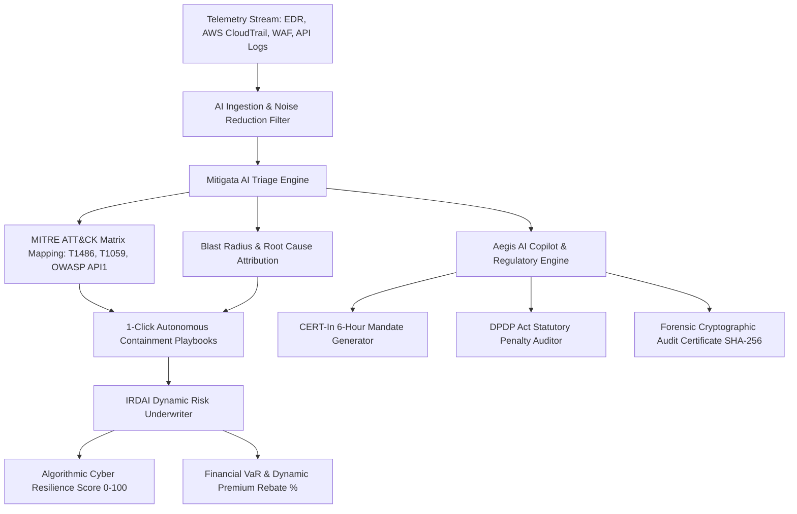

# AegisForge AI 🛡️
### Autonomous AI SOC Incident Triage & IRDAI Cyber Insurance Underwriting Engine
> **Built for Mitigata CyberForge Hackathon 2026**  
> *Theme: AI in Cybersecurity — Practical, Working & High-Impact Cyber Resilience*

---

## 🚀 Live Demo & Quickstart

```bash
# 1. Install dependencies
npm install

# 2. Start the local high-performance console
npm run dev
```
Open **[http://localhost:3000](http://localhost:3000)** in your browser.

---

## 🎯 Executive Summary & Alignment with Mitigata

**Mitigata** is India's pioneer in AI-native cyber resilience, operating an AI SOC that has triaged over 1M+ security incidents, while functioning as India's first IRDAI-regulated cyber insurance broker.

Most organizations struggle with a disjointed cybersecurity lifecycle:
1. **SOC Alert Fatigue:** Tier-1 analysts drown in false positives, resulting in slow Mean Time to Respond (MTTR).
2. **Disconnected Cyber Insurance:** Risk underwriting is static and backward-looking (annual paper questionnaires) rather than algorithmic and connected to real-time telemetry.
3. **Indian Regulatory Compliance (DPDP Act 2023 & CERT-In):** Strict 6-hour incident disclosure mandates and penalties up to ₹250 Crores require automated, immediate forensic audit readiness.

**AegisForge AI** bridges this critical gap. It is an end-to-end, autonomous cyber defense and underwriting engine that:
- **Triages complex multi-cloud incidents in < 50ms** using AI corroboration across EDR, CloudTrail, IDS, and API gateways.
- **Quantifies real-time Financial Value at Risk (VaR)** and computes dynamic **IRDAI Cyber Insurance Premium Discounts** as threats are autonomously contained.
- **Provides 1-Click / Auto-Pilot Remediation Playbooks** mapped to MITRE ATT&CK tactics.
- **Includes an AI Security Copilot** with built-in regulatory engines for **India DPDP Act 2023** and **CERT-In 6-Hour SLA Incident Disclosures**.

---

## 🏗️ Architecture & AI Pipeline



---

## 🌟 Key Features

### 1. Interactive Threat Injection Sandbox (Judge Demo Ready)
Simulate 4 real-world attack vectors with live telemetry ingestion:
- **LockBit 3.0 Ransomware:** LSASS credential dumping, VSS volume shadow copy deletion, and lateral SMB spread.
- **India DPDP Act PII Exfiltration:** Broken Object Level Authorization (BOLA/OWASP API1) leaking 120,000 Aadhaar & PAN records.
- **AWS Shadow Admin Escalation:** Compromised CI/CD runner key with unauthorized `AdministratorAccess` policy attachments.
- **GenAI Prompt Injection:** Indirect jailbreak payload extracting proprietary corporate RAG context.

### 2. IRDAI Cyber Insurance Dynamic Underwriting
- **Resilience Score (0-100):** Evaluates MFA posture, attack surface exposure, and active threat containment.
- **Financial Value at Risk (VaR):** Real-time rupee exposure breakdown (Regulatory fines, Business Interruption, Forensics).
- **Dynamic Policyholder Rebate:** Fulfills IRDAI loss-mitigation guidelines, rewarding rapid MTTR with up to **35% annual cyber insurance premium discounts**.

### 3. Attack Surface Topology & Live Threat Radar
- HTML5 Canvas visualizer rendering live network topology: Domain Controllers, Cloud Gateways, KYC databases, S3 buckets, and AI Copilots.
- Visual threat propagation paths and emerald containment shield halos.

### 4. Regulatory AI Copilot (CERT-In & DPDP Act 2023)
- Instant statutory draft generator conforming to **CERT-In Cyber Incident Directions Section 70B**.
- Risk analysis under **Section 33(1) of the Digital Personal Data Protection Act 2023**.

### 5. Cryptographic Proof of Audit Export
- One-click generation of Board-ready and Insurer-ready **Forensic Audit Certificates** with SHA-256 cryptographic verification hashes.

---

## 🛠️ Technology Stack
- **Frontend Core:** Modern ECMAScript (ES2024), HTML5, Canvas 2D
- **Styling & HUD:** Custom Glassmorphic CSS3 Design System with Neon Cyber-Defense Palette
- **Audio Synthesizer:** Procedural Web Audio API (zero audio asset dependencies)
- **Tooling:** Vite 8.3
- **Compliance Rulesets:** IRDAI Cyber Security Guidelines 2023, DPDP Act 2023, CERT-In Directions, MITRE ATT&CK v14.

---

## 📋 Hackathon Submission Details
- **Project Name:** AegisForge AI
- **Participant:** CyberForge Hackathon 2026 Candidate
- **Target Role:** Software Development Engineer (SDE) / AI & Cyber Resilience Builder at Mitigata
- **License:** MIT
